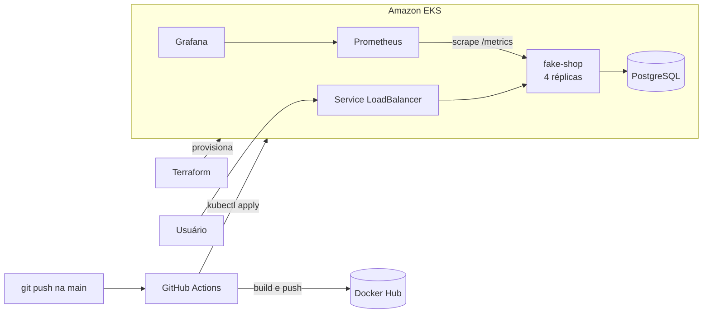

# AWS EKS DevOps Pipeline

Deploy de uma aplicação web (Flask + PostgreSQL) no Amazon EKS, com infraestrutura em Terraform, CI/CD em GitHub Actions e observabilidade com Prometheus e Grafana.

> Projeto construído a partir da aplicação de exemplo [KubeDev/fake-shop](https://github.com/KubeDev/fake-shop). A aplicação é de terceiros; a infraestrutura, os manifests, o pipeline e o monitoramento são deste repositório.

## Arquitetura



1. O Terraform cria a rede e o cluster EKS.
2. Cada push na `main` dispara o GitHub Actions: build da imagem, push no Docker Hub e `kubectl apply` dos manifests.
3. A aplicação roda com 4 réplicas atrás de um Service do tipo LoadBalancer.
4. O Prometheus coleta as métricas da aplicação (via annotations) e o Grafana exibe os dashboards.

## Stack

AWS · Amazon EKS · Kubernetes · Terraform · GitHub Actions · Docker · Docker Hub · Prometheus · Grafana · Flask · PostgreSQL

## Estrutura do repositório

```text
.
├── .github/workflows/   # pipeline de CI/CD
├── terraform/           # infraestrutura AWS (VPC + EKS)
├── k8s/                 # manifests da aplicação e do PostgreSQL
├── prometheus/          # deployment e configuração do Prometheus
├── grafana/             # prints dos dashboards
└── src/                 # aplicação fake-shop (Flask) + Dockerfile
```

## Como executar

**Pré-requisitos:** conta AWS, AWS CLI, Terraform, kubectl e conta no Docker Hub.

```bash
# 1. Infraestrutura
cd terraform
terraform init
terraform plan
terraform apply

# 2. Acesso ao cluster
aws eks update-kubeconfig --region <regiao> --name <nome-do-cluster>

# 3. Deploy manual (o pipeline faz isso a cada push)
kubectl apply -f k8s/
kubectl apply -f prometheus/
```

Secrets do GitHub Actions: `DOCKERHUB_USERNAME`, `DOCKERHUB_TOKEN`, `AWS_ACCESS_KEY_ID`, `AWS_SECRET_ACCESS_KEY` e `AWS_SECRET_REGION`.

Para não gerar custo, destrua tudo ao terminar:

```bash
kubectl delete -f k8s/ -f prometheus/
cd terraform && terraform destroy
```

## Resultado

**Aplicação rodando no EKS**


**Recursos no cluster**


**Dashboards no Grafana**


## Escolhas deste projeto e o que eu mudaria

| Escolha | Por que funciona aqui | Em produção eu faria |
| --- | --- | --- |
| Docker Hub como registry | Simples de integrar ao GitHub Actions | Amazon ECR, com acesso por IAM e sem credencial extra |
| Service do tipo LoadBalancer | Expõe a aplicação direto, sem componente adicional | Ingress com um único balanceador para vários serviços e HTTPS |
| Prometheus por annotations nos pods | Descoberta automática dos alvos, sem instalar operator | kube-prometheus-stack com ServiceMonitor |
| Access key da AWS em secrets do GitHub | Configuração rápida do pipeline | OIDC entre GitHub e AWS, sem chave estática |
| PostgreSQL dentro do cluster | Ambiente completo com um único `kubectl apply` | Amazon RDS, com backup e alta disponibilidade gerenciados |

## Próximos passos

- [ ] Autenticar o pipeline na AWS via OIDC, sem access key em secret
- [ ] Ingress com HTTPS (AWS Load Balancer Controller ou NGINX Ingress)
- [ ] HPA para a aplicação e Cluster Autoscaler para os nós
- [ ] State remoto do Terraform em S3 com lock no DynamoDB
- [ ] Mais dashboards no Grafana
